<div align="center">

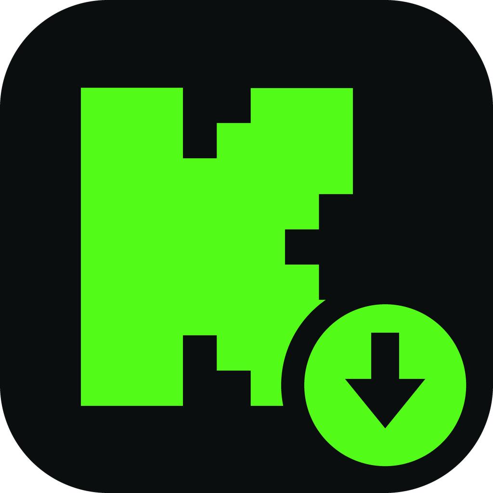

# Kick Downloader

**English** · [Türkçe](README.tr.md)

**Download Kick streams, clips and live streams as fast as your connection allows.**
Watch, cut out the moments you want, record live. All in one window.


<br>

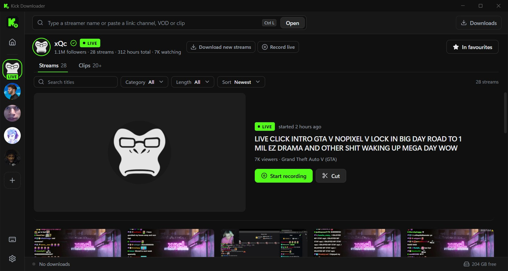

</div>

<br>

## Contents

[What it does](#what-it-does) · [Install](#install) · [How to use](#how-to-use) · [Shortcuts](#shortcuts) · [Settings and files](#settings-and-files) · [Updates](#updates) · [Troubleshooting](#troubleshooting) · [Privacy](#privacy) · [License and notices](#license-and-notices) · [Development](#development)

<br>

## What it does

### Open a streamer, see everything at a glance

Type a channel name in the top box, or paste a **channel / stream / clip link**. Streams and clips appear with thumbnails. Hover a card and a preview plays muted; click it to open the large window.

If the streamer is **live**, a full-width **live strip** leads the list: live preview, title, viewer count and two buttons (**Start recording**, **Cut**).

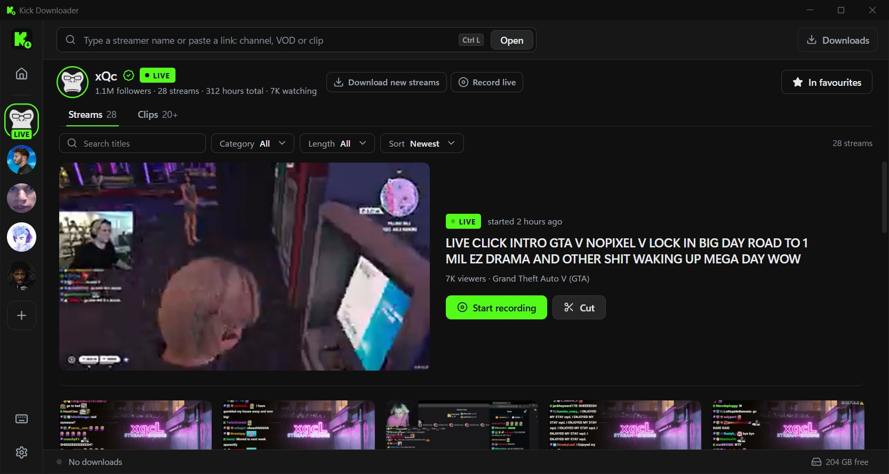

<table>
<tr>
<td width="50%" valign="top">

**Preview on hover**

Rest the pointer on a card and the video plays muted. Click it and the watch window continues from the same moment.

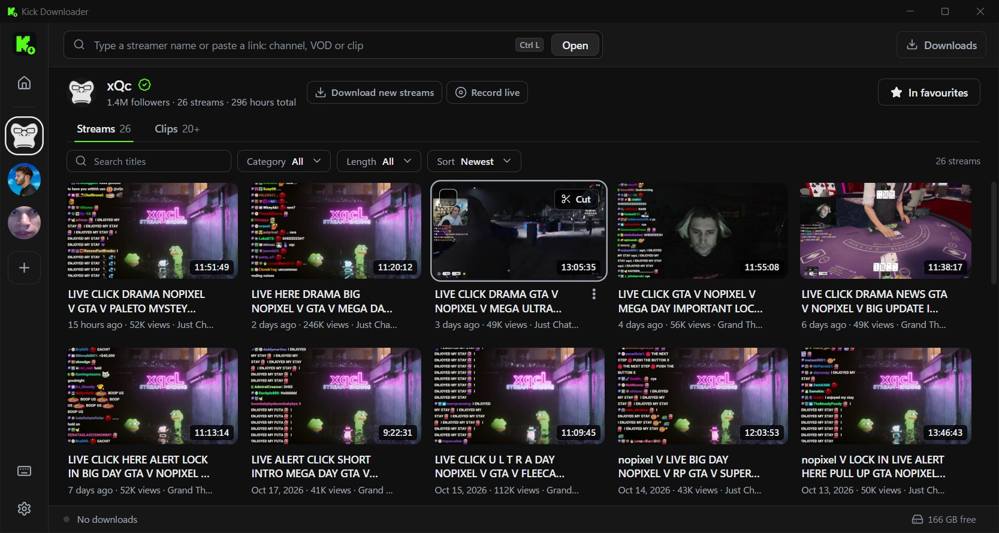

</td>
<td width="50%" valign="top">

**Favourite streamers**

Press the star and the streamer joins the left rail. A green ring shows when they go live, and a count shows new streams. Optionally, new streams download automatically and recording starts automatically when they go live.

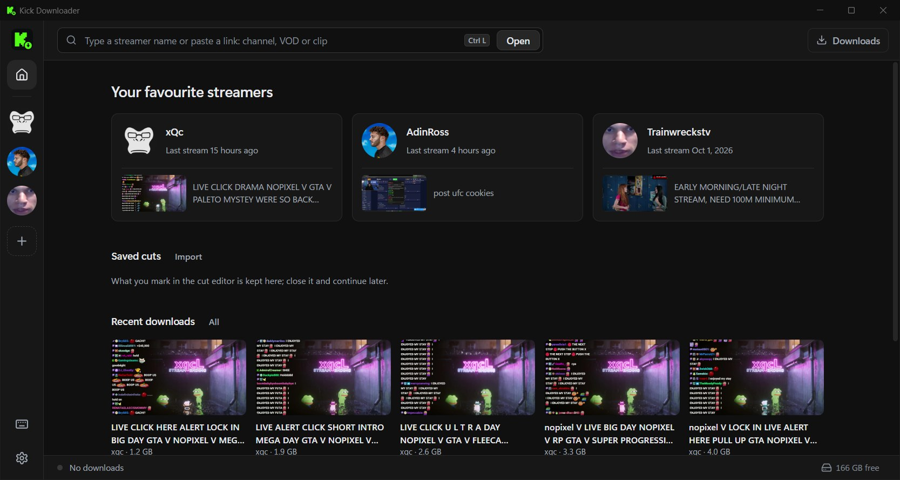

</td>
</tr>
</table>

<br>

### Watch in a large window

Click a video and a large window opens over a dimmed background. On the side are the **quality picker** and the actions: *Download all*, *Cut*, *Download chat*.

**← →** or the side arrows step to the previous / next video. **Esc** closes the window and stops playback.

The **chat** runs beside the video, in step with playback, for VODs, clips, live streams and downloaded files (the chat button in the player bar hides it). Scroll up to read back; *Back to now* follows the video again. Click a timestamp to jump there. Click messages to select them (**Shift** for a range), then **Copy** or **Save** them as a PNG image; the gear sets the background (dark / transparent), width, and whether time, badges and emotes are drawn. The cut editor has the same chat under its *Chat* tab.

**Chat video:** the chat can also be made into its own scrolling video, to put beside the stream in your editor (it is never burned into the stream video). Green screen gives an `.mp4` to key out; transparent gives a `.webm` with alpha (Premiere, DaVinci Resolve, OBS). Size, text size and whether time, badges and emotes show are in Settings → Chat. Make one three ways: tick *Video* among the chat file types (it is made with every chat download), *Make chat video* on a chat in Downloads, or the film button under messages selected in the chat panel (a short video of just those). About 4 minutes per hour of busy chat.

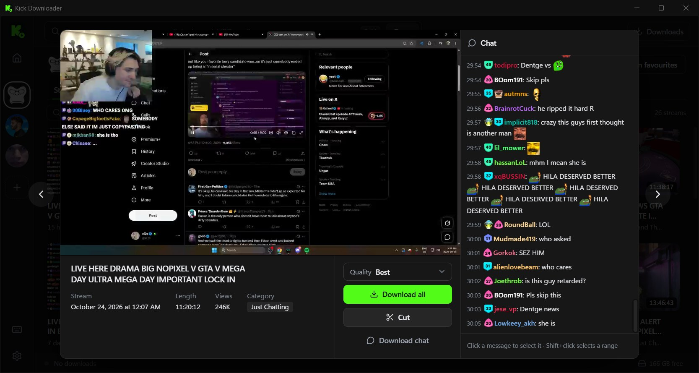

<table>
<tr>
<td width="50%" valign="top">

**Speed and quality**

The player bar has a speed menu (0.25× – 2×; **,** and **.** step it) and a quality menu: *Auto*, or a fixed resolution such as 720p60. Both stay for the next videos you open. A live stream has the quality menu only.

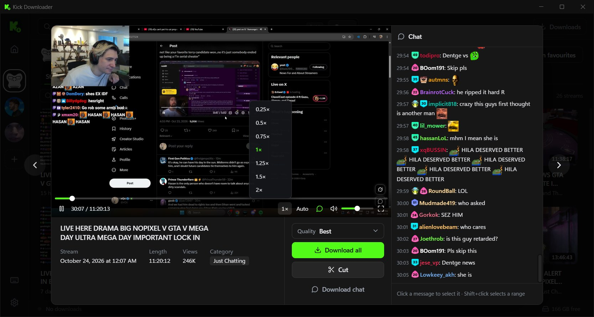

</td>
<td width="50%" valign="top">

**Pick chat messages**

Click a message, then **Shift**-click another to select everything between. **Copy** or **Save** makes a PNG image of them; the film button makes a short chat video of just those messages.

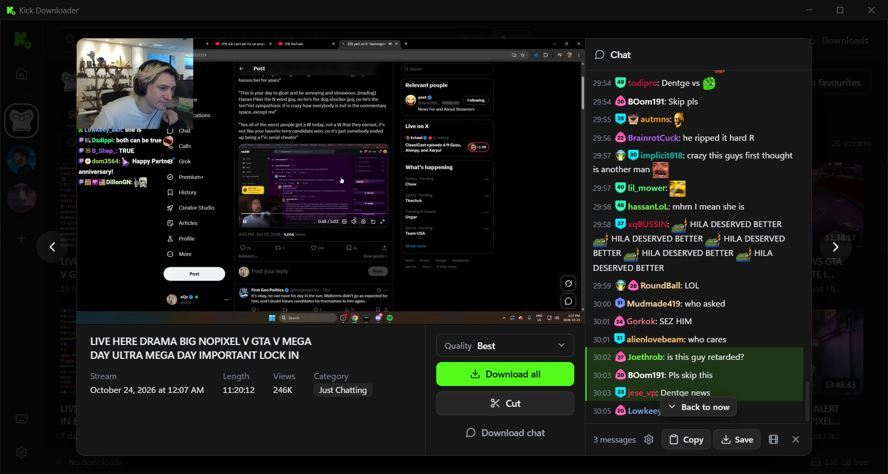

</td>
</tr>
</table>

Which chat files are saved, and how the chat video looks, are set in Settings → Chat:

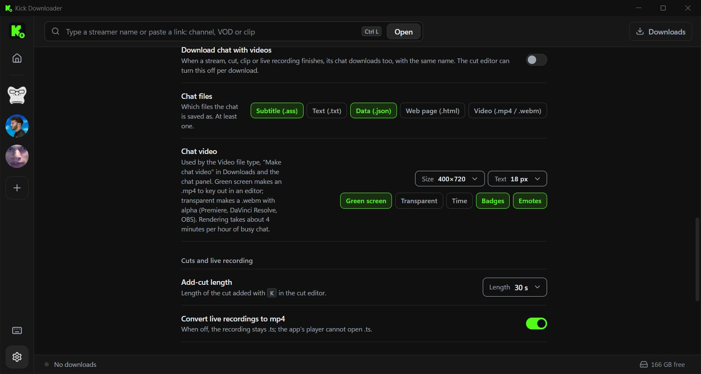

<br>

### Select many videos, download with one click

Press the box in a card's corner (or **Ctrl+click**) to start a selection. While selecting, a plain click adds or removes; to watch, use the **▶** in the card's centre. **Shift+click** selects everything in between.

A bar appears at the bottom: how many you picked, the **total length**, quality and **Download (n)**. Click the count to list your picks and remove any of them.

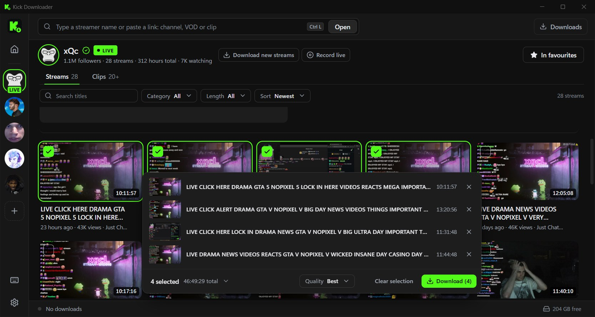

<br>

### A ⋮ menu on every card

The **⋮** button beside the title, or **right-click**. The menu follows the video's state: *Download* if not downloaded, *Stop* while downloading, *Resume* when stopped, *Play* and *Show in folder* when done. Also *Cut*, *Download chat*, *Open on Kick* and *Copy link*.

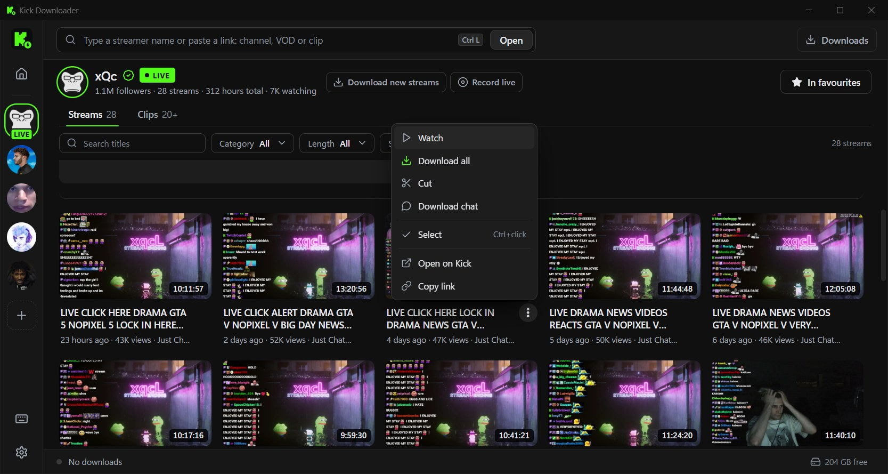

<br>

### Cut any moment out of a stream

**Cut** opens an editor-like window: a zoomable timeline (frame strip and audio waveform), frame preview on hover, drag scrubbing, **0.25× – 4×** playback speed.

- **K** adds a cut of preset length around the playhead. Adjust the edges by dragging or by typing times.
- Cuts download as **separate files** or as **a single video**.
- **Open in CapCut** downloads the cuts, lays them one after another in a new CapCut project at the stream's own size and opens CapCut (the chat video can be added too). CapCut for Windows must be installed.
- A **chat track** under the audio waveform shows how busy the chat is, minute by minute: tall bars are where something happened. It is a quick estimate from a sample of the chat, loaded in the background (about 30 seconds for a long stream), for finished streams only.
- Only the parts covering the range are downloaded. A 30-second cut from a 4-hour stream does not fetch 4 hours of data.
- You can cut from a live stream too: go back while it is still running and cut the moment you want.

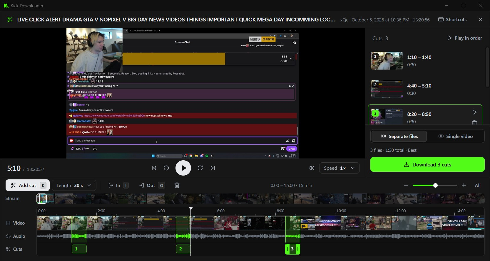

<br>

### Downloads: fast, readable, resumable

<table>
<tr>
<td width="50%" valign="top">

**Queued and downloading**

Cards show their state (*Downloading 37%*, *Queued*, *Downloaded*). The bottom bar shows total progress, time left, speed and free disk space.

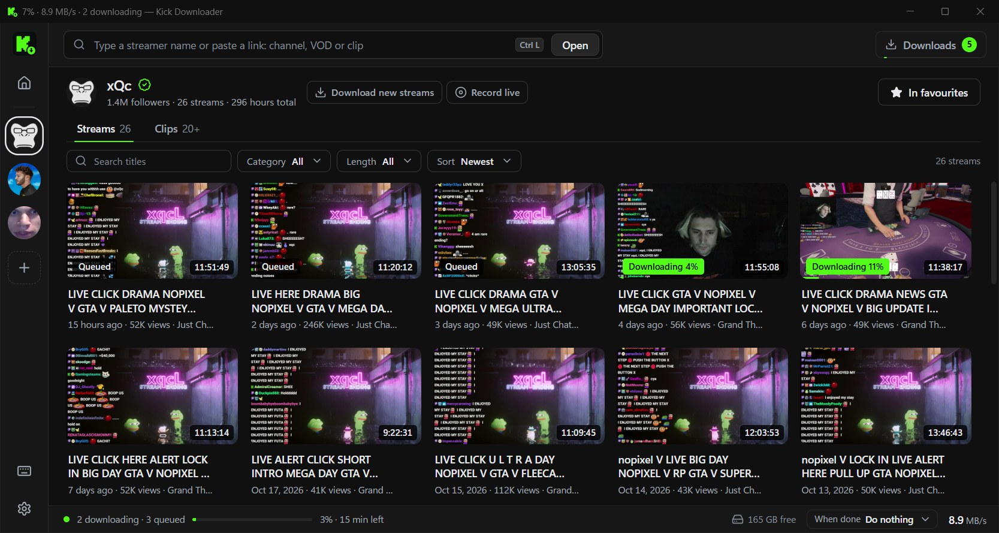

</td>
<td width="50%" valign="top">

**Downloads**

Finished files are grouped by day. A file plays inside the app, opens in the Windows player, is shown in its folder or goes to the Recycle Bin.

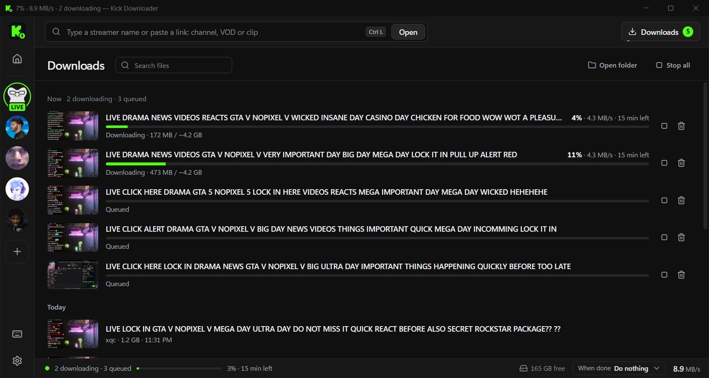

</td>
</tr>
</table>

### More

| | |
|---|---|
| **No speed tuning** | The app measures total speed and decides how many videos download at once (1–6). Each video fetches its parts over 8–32 connections. |
| **Speed limit** | Cap the total speed so the line is not full while you game or watch streams. |
| **Live recording** | Records a live stream from now on. When it ends, the `.ts` file becomes `.mp4`. |
| **Download chat** | Downloads the full chat of a stream, cut, clip or live recording: `.ass` subtitle (VLC / MPC scroll it over the video), `.txt`, `.json`, `.html`. With *Download chat with videos* on, it comes with every download. |
| **Chat video** | Makes the chat into its own scrolling video to put beside the stream in your editor. Green screen `.mp4` or transparent `.webm`; size, text size and time / badges / emotes are in Settings → Chat. Also made from a chat in Downloads or from the messages selected in the panel. |
| **Resume** | If the app closes, unfinished downloads continue on next start with *Resume*. |
| **Disk guard** | Free space is checked before a download starts. A download that does not fit fails with a clear message; the rest of the queue continues. |
| **When done** | When the queue finishes: do nothing, sleep, or shut down (60 s countdown, cancellable). |
| **Clipboard and drag-and-drop** | When you return to the window with a Kick link on the clipboard, the app offers to open it. Drop a link from the browser onto the window, or paste it with Ctrl+V. |
| **Windows notifications** | When the queue finishes and when a favourite goes live. Both can be turned off in Settings. |
| **File name template** | For example `{channel} - {title} [{id}]`: `{channel}` `{title}` `{date}` `{id}` are available. The older `{kanal}` `{baslik}` `{tarih}` names still work. |
| **Interface language** | English and Turkish. Picked from the Windows language on first start; change it in Settings → App → Language. |
| **Single instance** | Opening the app again brings the existing window to the front. |
| **Update check** | Checks the latest release on GitHub at startup and shows a notice when a new one is out. |

<br>

## Install

### One-click installer (recommended)

1. Download **`KickIndirici-Setup-….exe`** from the [**Releases**](https://github.com/Cabro57/kick-indirici/releases/latest) page.
2. Open it and press **Install**. No administrator rights needed. A Start menu shortcut is added and `ffmpeg` is included.

> If Windows shows a "protected your PC" (SmartScreen) warning, press **More info → Run anyway**. It appears because the program is not signed yet.

### Without installing (zip)

Extract `KickIndirici-…-windows.zip` to a folder and open **`KickIndirici.exe`**. `ffmpeg.exe` must stay next to the exe.

> Without ffmpeg, videos still download, but cuts, live recording and the final mp4 fix-up do not work.

### Requirements

| | |
|---|---|
| **Operating system** | Windows 10 or 11 |
| **WebView2 Runtime** | Included in Windows 11. If missing, the app offers the download page at startup. |
| **.NET Framework 4.6.2+** | Included in Windows. |
| **ffmpeg** | For cuts, live recording and the mp4 fix-up (included in the installer and the zip) |

### Run from source

```bash
git clone https://github.com/Cabro57/kick-indirici-src.git
cd kick-indirici-src
pip install -r requirements.txt
python kick_indir.py
```

`baslat.bat` does the same without a console window. Install ffmpeg yourself: `winget install Gyan.FFmpeg`, or the "release essentials" build from [gyan.dev](https://www.gyan.dev/ffmpeg/builds/).

<br>

## How to use

1. **Open.** Type `kick.com/xqc`, just `xqc`, a stream link or a clip link in the top box. A clip link goes straight to downloading.
2. **Pick.** On the Streams tab, click a video to watch it, or multi-select with the boxes in the card corners.
3. **Download.** *Download all*, *Download clip* or *Cut*. The app does the rest.
4. **Find.** The *Downloads* button (Ctrl+J) shows finished files. Files go to `User\Downloads\Kick` by default.

> **Tip:** To see what happens where in a stream, rest the pointer on its card. On long streams the preview starts at about 20%, not at the beginning.

<br>

## Shortcuts

Press **?** in the app to see the list.

<table>
<tr>
<td valign="top" width="50%">

**General**

| Key | Action |
|---|---|
| `Ctrl` `L` | Go to the link box |
| `Ctrl` `V` | Paste a link and open it |
| `Ctrl` `J` | Downloads |
| `?` | Shortcut list |

**Videos**

| Key | Action |
|---|---|
| Click | Watch (while selecting: add / remove) |
| `Ctrl` click · `Space` | Add to / remove from selection |
| `Shift` click | Select everything in between |
| `Ctrl` `A` | Select all |
| `Esc` | Clear selection |

</td>
<td valign="top" width="50%">

**Player**

| Key | Action |
|---|---|
| `K` | Play / pause |
| `M` | Mute / unmute |
| `F` | Full screen |
| `,` `.` | Slower / faster |
| `←` `→` | Previous / next video |
| `Esc` | Close |

**Cut editor**

| Key | Action |
|---|---|
| `K` | Add cut |
| `I` / `O` | In / out point |

All editor shortcuts are under the **Shortcuts** button at its top right.

</td>
</tr>
</table>

<div align="center">
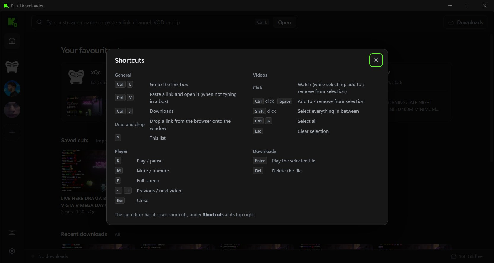
</div>

<br>

## Settings and files

<table>
<tr>
<td width="55%" valign="top">

Open Settings with the gear at the bottom left: interface language, download folder, default quality, file name template, videos at once, connections per video, speed limit, preview and player behaviour, notifications, default cut length and update check.

**Quality:** Best · 1080p60 · 720p60 · 480p · 360p · 160p. If the requested quality is missing, the nearest lower one downloads.

</td>
<td width="45%" valign="top">

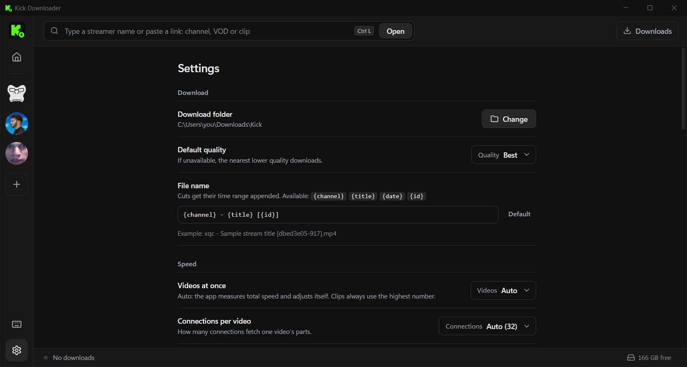

</td>
</tr>
</table>

The app keeps its data in `%APPDATA%\KickIndirici\`

| File | Contents |
|---|---|
| `settings.json` | Settings and favourite streamers |
| `history.json` | Download history |
| `queue.json` | Unfinished downloads |
| `log.txt` | Debug log |

<br>

## Updates

When a new version is out, the app tells you at startup (this can be turned off in Settings) and updates itself; only the changed files are downloaded.

- **Update:** the new version downloads in the background. Press **Restart** when it finishes to switch at once; if you do not, the new version opens the next time you start the app.
- **Update and restart:** downloads and reopens with the new version straight away.

It works the same from the zip, as long as the folder is writable.

Your settings and history live in `%APPDATA%`, so an update does not lose them.

<br>

## Troubleshooting

<details>
<summary><b>The window opens black</b></summary>

<br>

WebView2 Runtime may be missing or broken. The app checks this at startup and offers the download page. If the installer says "already installed", first uninstall WebView2 Runtime from *Apps*, then reinstall it with the standalone installer.

On Windows 10, some graphics drivers draw WebView2 black. The app then turns the GPU off by itself; the `--gpu` / `--no-gpu` flags choose manually.

</details>

<details>
<summary><b>"ffmpeg not found" warning</b></summary>

<br>

Put `ffmpeg.exe` next to `KickIndirici.exe` or add it to PATH. If `ffmpeg -version` works in a terminal, the app finds it too.

</details>

<details>
<summary><b>A download fails with "403"</b></summary>

<br>

Kick denied access. Retry; if it continues, the video may be deleted or subscriber-only.

</details>

<details>
<summary><b>A live recording stayed <code>.ts</code></b></summary>

<br>

*Convert live recordings to mp4* is off in Settings. The app's player cannot open `.ts`; open it in the Windows player or turn the setting on.

</details>

<details>
<summary><b>Something goes wrong</b></summary>

<br>

Check `%APPDATA%\KickIndirici\log.txt`. When running from source, `python kick_indir.py --debug` opens the developer tools.

</details>

<br>

## Privacy

The app asks once, in the installer and again on first start, whether it may send **anonymous usage data**. Nothing is sent until you answer, and *No* means nothing is ever sent. Change it any time in **Settings → App → Send anonymous usage data** (*What is sent?* shows the full list).

**Sent:** app version, Windows version and language; a random install ID made on your computer (not linked to you); hardware (processor, core count, memory, graphics card, screen, whether the download folder is on an SSD or HDD); for each download its type, the **channel name**, size, duration, speed and download settings; which features are used (cut editor, chat panel, chat video, live recording…); errors (error type and where in the code, with folders and your user name removed).

**Never sent:** your IP address (not stored), video links or titles, file names or folders, your Windows user name, anything you type.

The data goes to [PostHog](https://posthog.com) servers in the EU and is used only to see how many people use which version, how fast downloads are on real connections, and which errors to fix first.

<br>

## License and notices

- `ffmpeg.exe` belongs to the [FFmpeg](https://ffmpeg.org) project and is licensed under GPLv3. The licence text and source code information are in `LICENSE-ffmpeg.txt` in the zip.
- This program is not affiliated with or endorsed by Kick. It was written for personal use, such as backing up your own streams or archiving content you are allowed to keep. Copyright in downloaded content belongs to the streamers; following Kick's terms of use and the streamers' rights is your responsibility.
- The *Kick* name and the "K" symbol belong to Kick. The logo in this repository is for personal use; a distributed version should use its own icon.

<br>

## Development

The interface is HTML / CSS / JS (`web/`), the engine is Python. **pywebview** (Edge WebView2) draws the window; downloads use `yt-dlp`, network requests `curl_cffi`, cutting and merging `ffmpeg`.

```
kick_indir.py     Entry point (adds src/ to the path and calls kickindir.app.main)
src/kickindir/    Python engine
  config.py         Constants, file paths, app folders
  app.py            Window, single-instance check, main()
  api/              The Api exposed to the interface: __init__.py combines the general, updates,
                    queue_control, workers, library, favorites, cuts and browse parts
  services/         kick (Kick API), chat, media (previews, media server), notify (notifications),
                    updater (manifest-based file updates)
  core/             engine (speed limiter, download record), storage (settings, queue, history), prefs,
                    i18n (interface language), util
web/              Interface (index.html, app.css, app.js, i18n.js, hls.js in vendor/)
  i18n/             Language files: en.json (source), tr.json
assets/           Logo and app icon
tools/make_logo.py  Script that builds the logo and icon
tools/make_manifest.py  Script that builds a release's manifest.json
tools/check_i18n.py  Checks the language files (missing keys, mismatched placeholders)
tools/screenshots.py  Takes the README screenshots: python tools/screenshots.py en <channel> ... (uses a temporary data folder, downloads nothing)
PRODUCT.md        What the product does and its constraints
DESIGN.md         Visual design system
PERF.md           Speed experiments and results
```

**Interface text:** never hard-code text; use keys. In JS `t("key", { n })`, in HTML `data-i18n="key"`, in Python `t("key", n=1)`. Add each new key to both `web/i18n/en.json` and `tr.json`, then run `python tools/check_i18n.py`. For English plurals the value can be `{"one": "…", "other": "…"}`. For a new language, add `web/i18n/<code>.json` and list it in `LANGS` in `src/kickindir/core/i18n.py`.

**Build the single-file exe:**

```bash
exe_yap.bat
# or
python -m PyInstaller --noconfirm KickIndirici.spec
```

The output is `dist\KickIndirici.exe`. [Inno Setup 6](https://jrsoftware.org/isinfo.php) builds the installer (`dist\KickIndirici-Setup-<version>.exe`) with `ISCC /DAppVersion=1.0.0 installer\KickIndirici.iss`. The installer is English and Turkish and follows the Windows language.

**Releasing:** bump `VERSION` in `src/kickindir/config.py`, commit, then `git tag v1.0.1 && git push --tags`. `.github/workflows/release.yml` builds the exe, the installer and the zip and uploads them as a release to the [kick-indirici](https://github.com/Cabro57/kick-indirici) repository. The in-app updater reads that release's `manifest.json` and downloads only the changed files (verified with SHA-256); if the manifest cannot be read, it falls back to the installer. To ship a new file, add it to the `make_manifest.py` line in the workflow. This repository needs a `RELEASE_TOKEN` secret (a fine-grained token with *Contents: write* on kick-indirici). See [PERF.md](PERF.md) for the speed experiments.
